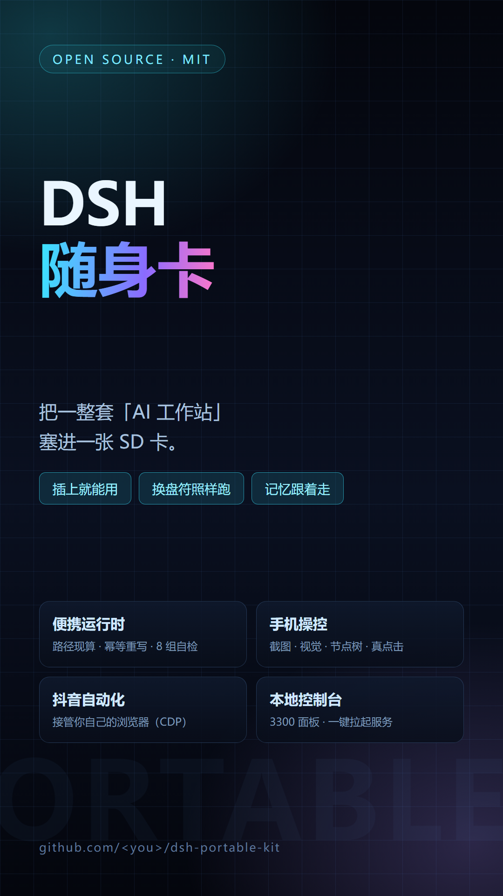

# DSH Portable Kit

> A whole local "AI that actually does things" stack on one SD card. Plug it in, it just works — on any Windows machine.

<p align="center">
  
</p>

---

## What this is

[DSH](https://github.com/deepseek-ai) (DeepSeek Harness) is a local AI agent that can read and write files,
run commands and drive a browser. This repo is **not** another agent. It solves the part everyone skips:

> How do you turn that agent into something **portable, and with real hands**?

| Module | Problem it solves | Dir |
| --- | --- | --- |
| **Portable runtime** | The whole stack (runtime + config + memory + plugins) lives on an SD card. Drive letters change; it still runs. | [`portable/`](portable/) |
| **Phone control** | The agent actually taps a real phone: screenshot → vision → tap → type Chinese → UI-tree fallback | [`tools/phone/`](tools/phone/) |
| **Douyin automation** | Drives your own browser over CDP: browse, scrape, DM, auto-share by topic | [`scripts/douyin/`](scripts/douyin/) |
| **Local console** | A 3300-port web panel to start/restart the QQ bridge, SnowLuma, and DSH itself | [`console/`](console/) |

The companion QQ bot bridge is a separate public project:
[**Derpyu520/qq-bridge**](https://github.com/Derpyu520/qq-bridge). This repo links to it and does not copy its code.

---

## Why it is not just another dotfiles repo

### 1. Real portability: it survives a drive-letter change

Hard-coded absolute paths are where every "green/portable build" dies. Here they are **rewritten idempotently on every launch**:

```bat
:: every path in start-dsh.bat is derived from %~dp0 at run time
set "DSH_HOME=%ROOT%\.dsh"
set "DSH_WORKSPACE=%ROOT%\workspace"
set "PATH=%ROOT%\node;%PATH%"
```

- [`portable/portable-repath.mjs`](portable/portable-repath.mjs) rewrites MCP server commands, dependency
  paths and plugin entry points to real paths under the current root — **run it a hundred times, same result**.
- [`portable/portable-verify.mjs`](portable/portable-verify.mjs) does 8 groups of self-checks: node executable,
  leftover absolute paths, plugins as real dirs (not links), memory/persona/credentials present, **no symlinks in the tree**.
  Exit `0` all green / `1` failures / `2` fatal.

One real trap: SD cards are usually **exFAT**, and exFAT **does not support junctions or symlinks**.
The kit ships the "materialise links into real dirs" copy logic, and the verifier asserts a link-free tree —
so a stray junction cannot creep back in silently.

### 2. Declarative stripping

Two 34 GB voice models do not fit on the card? Don't touch the code, write one line:

```text
# portable-strip.txt — one config-block id prefix per line
mcp-tts-voice
```

`repath` removes that indented block from `cordis.patch.yml` entirely and leaves a comment saying who removed it.
Want it back? Delete the line and re-run.

### 3. Phone control: vision for meaning, UI-tree for coordinates

Pure vision-based tapping jitters badly on real devices (DPI, scaling, notches, `dumpsys` coordinate mismatch).
The rule here is:

```
screenshot → grid overlay → vision model reads meaning → uiNodes()/findNode() gives real cx/cy → tap
```

- Screenshot, grid, compression and PNG header/tail validation in one chain (a truncated PNG surfaces as `upstream_error`).
- Chinese input without an IME: ADBKeyboard base64 broadcast `am broadcast -a ADB_INPUT_B64 --es msg <base64>`.
- Wireless ADB first: USB keeps dropping, so `adb pair <ip>:<port> <code>` then `_adb-tls-connect`.
- See [docs/手机操控.md](docs/手机操控.md).

### 4. Douyin automation: your browser, not a headless one

No fake logins, no risk-control API abuse. Launch your own Edge/Chrome with `--remote-debugging-port=9222`,
then drive the real page over CDP — account state, feed and DMs are genuinely yours.

- `browse.mjs` — scroll the feed, capture title/author/duration
- `dm.mjs` — list conversations, open one, send a message
- `auto-share-watch.mjs` — pick videos by topic and DM-share them (with budget and time window)

See [docs/抖音自动化.md](docs/抖音自动化.md).

### 5. Vendor-ROM adaptation field notes

Honor's MagicOS iAware freezes third-party processes **even in the foreground**, and blocks third-party
`NotificationListenerService` binds at the system layer. [docs/MagicOS适配实录.md](docs/MagicOS适配实录.md)
records what the logcat evidence looks like, which adb-level exemptions are useless, and what the user must click manually.

---

> Docs are written in Chinese (the primary language of this project); the README is mirrored in English.

## Quick start

**A. Build your own stack from this repo**

```bash
git clone https://github.com/<you>/dsh-portable-kit.git
cd dsh-portable-kit
node portable/portable-verify.mjs   # shows what is missing (lots of failures at first: expected)
```

Then follow [docs/便携卡使用说明.md](docs/便携卡使用说明.md), drop `node/`, `.dsh/` and `workspace/` on the card, and run `start-dsh.bat`.

**B. Just make your existing stack portable**

1. Copy `portable/*` into the root of your current stack;
2. Run `node portable-repath.mjs` (rewrites hard-coded paths relative to the current root);
3. Run `node portable-verify.mjs` and clean up whatever it reports.

---

## Layout

```text
dsh-portable-kit/
├── portable/            # portable runtime: launch, path rewrite, verify, sync
├── tools/phone/         # phone control: ADB + vision + UI tree + Chinese input
├── scripts/douyin/      # Douyin automation over CDP
├── console/             # local console (web panel on :3300)
├── docs/                # docs (Chinese primary, key docs mirrored in English)
├── examples/            # copy-and-edit templates (strip list, panel config, persona card)
└── assets/              # promo images and screenshots
```

---

## Requirements

| Item | Requirement |
| --- | --- |
| OS | Windows 10 / 11 x64 (the scripts are `.bat` + PowerShell) |
| Node | ≥ 22.13 (unnecessary if you carry the portable node on the card) |
| Phone | Android 11+, USB or wireless debugging enabled |
| Browser | Edge or Chrome (CDP for the Douyin scripts) |
| Disk | ≥ 64 GB card recommended (~22 GB without voice models) |

---

## Known limits

- **exFAT has no permissions.** Lose the card, or plug it into a shared PC, and the credential files inside are plaintext. Don't.
- **Don't run `pnpm install` on the card.** exFAT write amplification and link semantics make it slow and fragile. Install on NTFS, then sync.
- **Voice models are excluded by default** (34.4 GB together). Add them back on demand (see the strip-list doc).
- **Python venvs are not portable.** `venv` bakes in the host Python path; rebuild after moving.
- **Phone control needs a vision model key.** And do not tap with vision coordinates — use the UI tree.
- **MagicOS / some Chinese ROMs** need a manual whitelist; adb cannot change it (see `docs/MagicOS适配实录.md`).

---

## Privacy

This repo contains **no** personal paths, device serial numbers, account nicknames, API keys or chat logs.
Everything sensitive is an environment variable — see [docs/配置说明.md](docs/配置说明.md).
If you fork and self-host, keep `.env` / `panel.config.json` / credential files in `.gitignore` (pre-configured).

---

## License

MIT — see [LICENSE](LICENSE).

Credits:

- [DeepSeek Harness](https://github.com/deepseek-ai) — the agent runtime this kit wraps around.
- [Derpyu520/qq-bridge](https://github.com/Derpyu520/qq-bridge) — QQ bot bridge (MIT).
- [ql0423/dsh-screen](https://github.com/ql0423/dsh-screen) — desktop control plugin (MIT); code not copied here.
- [ADBKeyboard](https://github.com/senzhk/ADBKeyBoard) — the Chinese input approach.