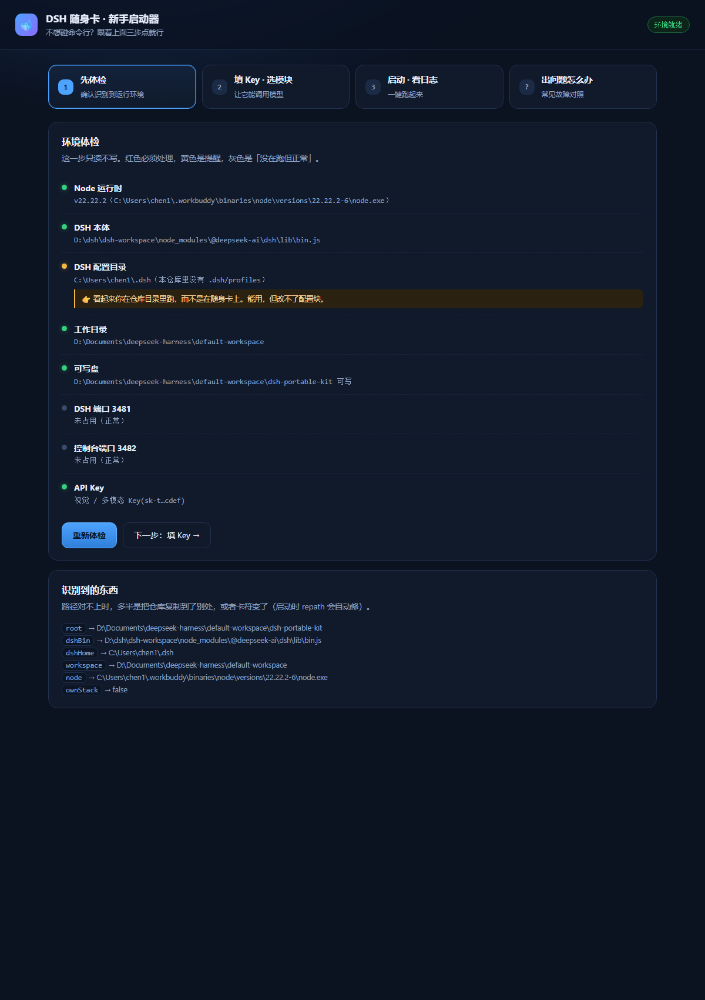
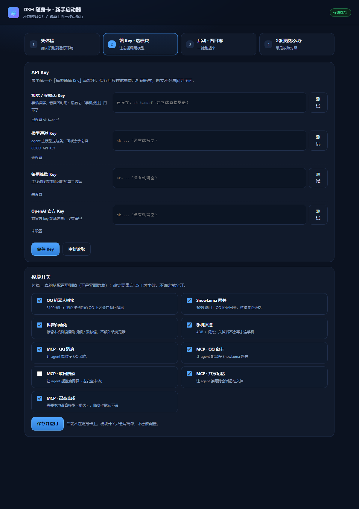
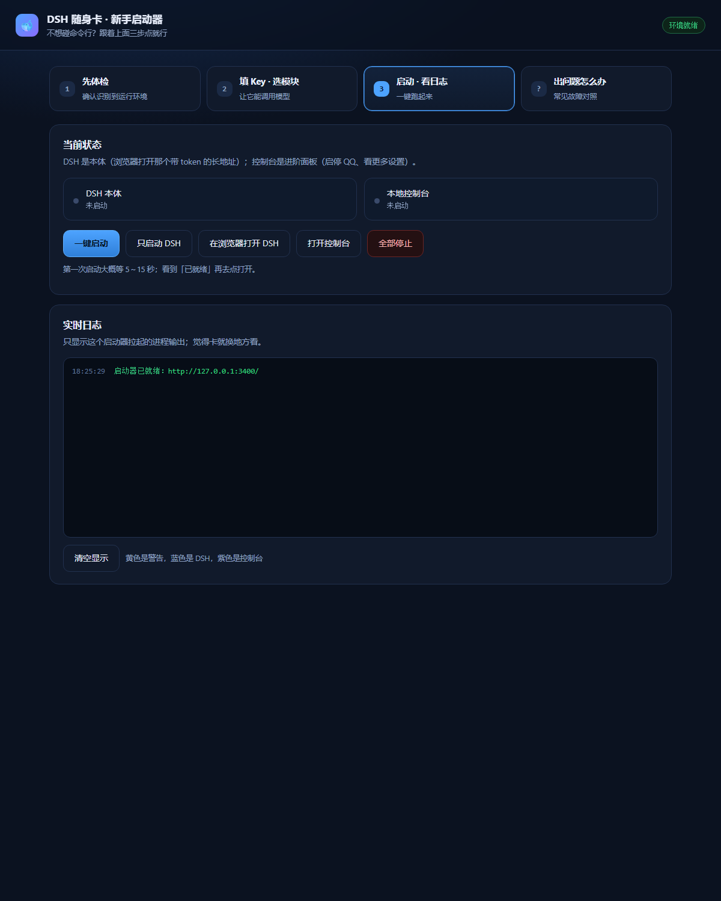
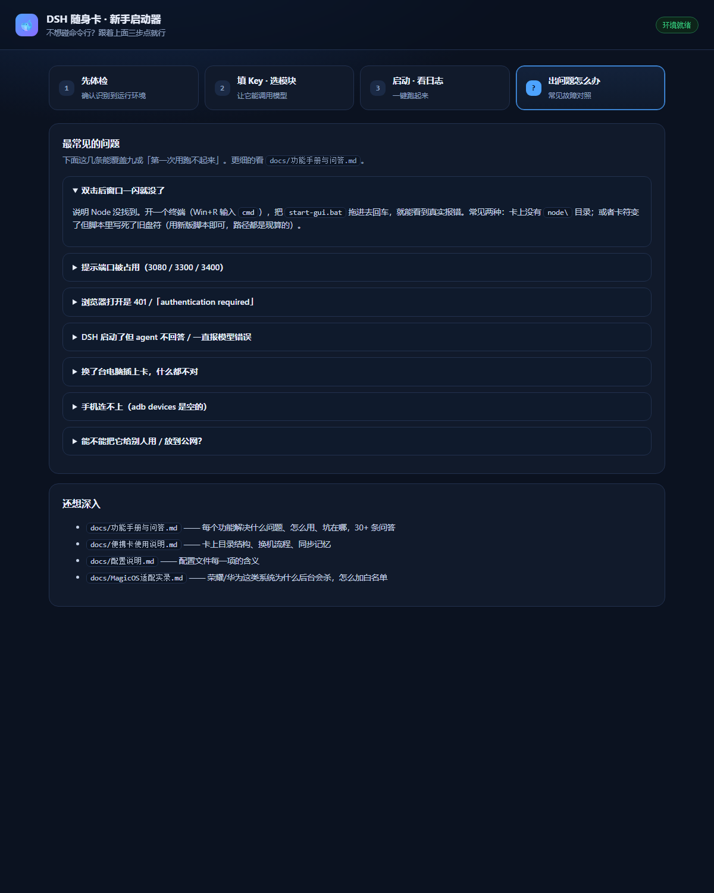

# DSH Portable Kit

> A whole local "AI that actually does things" stack on one SD card. Plug it in, it just works — on any Windows machine.

<p align="center">
  
</p>

---

## 30-second version

| What you get | What you do |
| --- | --- |
| A whole local AI stack that **actually acts**: reads/writes files, runs commands, sees a real phone screen and taps it, drives your own browser on Douyin, and can host a QQ bot | **Double-click `start-gui.bat`** and click through 4 steps in the browser |

**Three steps (this is all a beginner needs)**

1. **Double-click `start-gui.bat`** — finds Node by itself, starts a local page on `127.0.0.1:3400`, opens your browser.
2. **Follow the page** — ① health check (red/yellow/green, tells you exactly what is missing) → ② paste API keys, toggle modules → ③ hit "Start".
3. **Use it** — click "Open DSH in browser" to reach the agent UI; logs stream right below.

> If you do not want to read code, edit config files, or memorize commands, you can stop reading here.
> Stuck? See the [**handbook & Q&A**](docs/功能手册与问答.md) (30+ real gotchas).

---
## What this is

[DSH](https://github.com/deepseek-ai) (DeepSeek Harness) is a local AI agent that can read and write files,
run commands and drive a browser. This repo is **not** another agent. It solves the part everyone skips:

> How do you turn that agent into something **portable, and with real hands**?

| Module | Problem it solves | Dir |
| --- | --- | --- |
| **Portable runtime** | The whole stack (runtime + config + memory + plugins) lives on an SD card. Drive letters change; it still runs. | [`portable/`](portable/) |
| **GUI launcher** | Zero-dependency local page: health check, paste keys, toggle modules, one-click start/stop, live logs — beginners never touch a terminal | [`launcher/`](launcher/) |
| **Phone control** | The agent actually taps a real phone: screenshot → vision → tap → type Chinese → UI-tree fallback | [`tools/phone/`](tools/phone/) |
| **Douyin automation** | Drives your own browser over CDP: browse, scrape, DM, auto-share by topic | [`scripts/douyin/`](scripts/douyin/) |
| **Local console** | A 3300-port web panel to start/restart the QQ bridge, SnowLuma, and DSH itself | [`console/`](console/) |

The companion QQ bot bridge is a separate public project:
[**Derpyu520/qq-bridge**](https://github.com/Derpyu520/qq-bridge). This repo links to it and does not copy its code.

---

## Why it is not just another dotfiles repo

### 1. Beginner entry point: one double-click, the rest is clicking

Command lines are the number-one reason people bounce. So there is a **zero-dependency GUI launcher** (Node built-ins only — not even `npm install`):

```text
double-click start-gui.bat → it finds Node → serves 127.0.0.1:3400 → 4 steps in the browser
```

- **① Health check** — 8 items at once: Node version, DSH binary, config dir, workspace, disk writability, both ports, API keys. Red/yellow/green dots plus a fix hint per item.
- **② Keys & modules** — paste four kinds of API keys (read-back shows only `sk-d…3456`); 9 module checkboxes (QQ bridge / SnowLuma / Douyin / phone / 5 MCP tools). Unchecking really removes the config block.
- **③ Start & logs** — one-click start for DSH + console, auto-detects the tokenized URL DSH prints, live log tail; stopping kills the whole process tree.
- **④ Troubleshooting** — common failures are answered inline, no doc-diving needed.

The launcher and the console share `console/panel.config.json`, so it does not matter which UI you use.

<table>
  <tr>
    <td width="50%"><br><sub><b>1) Health check</b> — 8 items, red/yellow/green, fix hints inline</sub></td>
    <td width="50%"><br><sub><b>2) Keys &amp; modules</b> — 4 key types, masked read-back; 9 toggles</sub></td>
  </tr>
  <tr>
    <td><br><sub><b>3) Start &amp; logs</b> — DSH + console, tokenized URL auto-detected</sub></td>
    <td><br><sub><b>4) Built-in FAQ</b> — common failures answered on the page</sub></td>
  </tr>
</table>

> These are real UI screenshots (captured with headless Edge), not mockups.

### 2. Real portability: it survives a drive-letter change

Hard-coded absolute paths are where every "green/portable build" dies. Here they are **rewritten idempotently on every launch**:

```bat
:: every path in start-dsh.bat is derived from %~dp0 at run time
set "DSH_HOME=%ROOT%\.dsh"
set "DSH_WORKSPACE=%ROOT%\workspace"
set "PATH=%ROOT%\node;%PATH%"
```

- [`portable/portable-repath.mjs`](portable/portable-repath.mjs) rewrites MCP server commands, dependency
  paths and plugin entry points to real paths under the current root — **run it a hundred times, same result**.
- [`portable/portable-verify.mjs`](portable/portable-verify.mjs) does 8 groups of self-checks: node executable,
  leftover absolute paths, plugins as real dirs (not links), memory/persona/credentials present, **no symlinks in the tree**.
  Exit `0` all green / `1` failures / `2` fatal.

One real trap: SD cards are usually **exFAT**, and exFAT **does not support junctions or symlinks**.
The kit ships the "materialise links into real dirs" copy logic, and the verifier asserts a link-free tree —
so a stray junction cannot creep back in silently.

### 3. Declarative stripping

Two 34 GB voice models do not fit on the card? Don't touch the code, write one line:

```text
# portable-strip.txt — one config-block id prefix per line
mcp-tts-voice
```

`repath` removes that indented block from `cordis.patch.yml` entirely and leaves a comment saying who removed it.
Want it back? Delete the line and re-run.

### 4. A GUI console: toggle modules, paste API keys

No YAML editing. `console/server.mjs` serves a local panel at `http://127.0.0.1:3300`
with a "Modules & API keys" card:

- **local services** — QQ bridge (3100), SnowLuma gateway (5099), Douyin automation, phone control;
- **MCP tool switches** — `mcp-snowluma`, `mcp-snowluma-host`, `mcp-web-search-safe`,
  `mcp-shared-memory`, `mcp-tts-voice`. Unchecking one appends a line to `portable-strip.txt`
  and re-runs `repath`, so the block is **actually removed** from the config — after restarting DSH
  the tools are gone from the model's tool list, not merely hidden in the UI;
- **API key inputs** — vision / multimodal, OpenAI-compatible, model channel, fallback route.
  Saved into `panel.config.json` (gitignored) and injected into every child process
  (SnowLuma, QQ bridge, DSH). Stored keys are **masked** (`sk-d…3456`) when read back.

Same logic over HTTP: `GET/POST /api/settings`.

> The panel binds to `127.0.0.1` only and accepts cross-origin requests solely from
> `http://127.0.0.1:3300`. It has **no auth** — anyone who can open this machine can read
> those settings anyway, so never expose port 3300 to a LAN.

### 5. Phone control: vision for meaning, UI-tree for coordinates

Pure vision-based tapping jitters badly on real devices (DPI, scaling, notches, `dumpsys` coordinate mismatch).
The rule here is:

```
screenshot → grid overlay → vision model reads meaning → uiNodes()/findNode() gives real cx/cy → tap
```

- Screenshot, grid, compression and PNG header/tail validation in one chain (a truncated PNG surfaces as `upstream_error`).
- Chinese input without an IME: ADBKeyboard base64 broadcast `am broadcast -a ADB_INPUT_B64 --es msg <base64>`.
- Wireless ADB first: USB keeps dropping, so `adb pair <ip>:<port> <code>` then `_adb-tls-connect`.
- See [docs/手机操控.md](docs/手机操控.md).

### 6. Douyin automation: your browser, not a headless one

No fake logins, no risk-control API abuse. Launch your own Edge/Chrome with `--remote-debugging-port=9222`,
then drive the real page over CDP — account state, feed and DMs are genuinely yours.

- `browse.mjs` — scroll the feed, capture title/author/duration
- `dm.mjs` — list conversations, open one, send a message
- `auto-share-watch.mjs` — pick videos by topic and DM-share them (with budget and time window)

See [docs/抖音自动化.md](docs/抖音自动化.md).

### 7. Vendor-ROM adaptation field notes

Honor's MagicOS iAware freezes third-party processes **even in the foreground**, and blocks third-party
`NotificationListenerService` binds at the system layer. [docs/MagicOS适配实录.md](docs/MagicOS适配实录.md)
records what the logcat evidence looks like, which adb-level exemptions are useless, and what the user must click manually.

---

> Docs are written in Chinese (the primary language of this project); the README is mirrored in English.

## Quick start

### Path A (recommended for beginners): double-click one .bat

```bash
git clone https://github.com/80355/dsh-portable-kit.git
```

Put the repo at the root of your card/folder (avoid `Program Files` or sync folders), then:

1. **Double-click `start-gui.bat`** — it finds Node itself (`node
ode.exe` → parent dir → system PATH), starts the local page and opens the browser.
2. Walk the page: **① health check → ② keys & modules → ③ start & logs**. Fix any red item first; green/yellow is fine to start.
3. Click "Start", then "Open DSH in browser".

No `npm install`, no manual config editing. See chapter 2 and section 12 of chapter 3 in the [handbook](docs/功能手册与问答.md).

### Path B: build a full card from scratch

```bash
node portable/portable-verify.mjs   # tells you what is missing (lots of failures at first is normal)
```

Then follow [docs/便携卡使用说明.md](docs/便携卡使用说明.md) to copy the DSH runtime in,
add `node/`, `.dsh/`, `workspace/`, and finally run `start-dsh.bat`.

### Path C: just make your existing install portable

1. Copy `portable/*` into the root of your existing stack;
2. Run `node portable-repath.mjs` (rewrites hard-coded paths to point at the current root);
3. Run `node portable-verify.mjs` and clear the errors one by one.

---
## Layout

```text
dsh-portable-kit/
├── start-gui.bat        # beginner entry point: one double-click
├── launcher/            # GUI launcher (:3400 — health check / keys / modules / start-stop / logs)
├── portable/            # portable runtime: launch, path rewrite, verify, sync
├── tools/phone/         # phone control: ADB + vision + UI tree + Chinese input
├── scripts/douyin/      # Douyin automation over CDP
├── console/             # local console (web panel on :3300)
├── docs/                # docs (Chinese primary, key docs mirrored in English)
├── examples/            # copy-and-edit templates (strip list, panel config, persona card)
└── assets/              # promo images and screenshots
```

---

## Docs

| Doc | For | Covers |
| --- | --- | --- |
| [**Handbook & Q&A**](docs/功能手册与问答.md) | **everyone, especially beginners** | what each feature is for, two ten-minute paths, per-feature deep dive, CocoAPI picks, 30+ Q&As, cheat-sheet appendix (Chinese) |
| [Portable card guide](docs/便携卡使用说明.md) | building your own card | card layout, copy & sync, moving machines |
| [Phone control](docs/手机操控.md) | driving a real phone | ADB, wireless pairing, UI tree, Chinese input, vision chain |
| [Douyin automation](docs/抖音自动化.md) | automating Douyin | CDP takeover, script usage, budgets and caution |
| [Configuration](docs/配置说明.md) | editing config | `cordis.patch.yml` / `panel.config.json` / env var table |
| [Architecture](docs/架构.md) | reading / extending code | layers, startup sequence, trade-offs |
| [MagicOS field notes](docs/MagicOS适配实录.md) | fighting vendor ROMs | real logcat evidence, useless adb exemptions, the three manual steps |

---

## Model gateway: CocoAPI (recommended)

Without a model key this stack is an empty shell. The author uses [**CocoAPI**](https://api.cocoapi.top),
an **OpenAI-compatible aggregator** at `https://api.cocoapi.top/v1` — same wire format as OpenAI, so every script here
works by pointing `baseURL` at it.

- Directly reachable from mainland China (no network gymnastics just to call an API);
- One key unlocks many models (118 in `/v1/models` at the time of writing: Claude / GPT / Gemini / DeepSeek / Grok / Kimi / GLM / Qwen …);
- Pay with Alipay/WeChat, no international credit card;
- The project reserves `COCO_KEY` (vision) plus `COCO_API_KEY` / `COCO233_API_KEY` (primary / backup line).

| Purpose | Field in the panel | Env var |
| --- | --- | --- |
| Phone screen reading (**must support image input**) | Vision / multimodal key | `COCO_KEY` |
| Agent main chat & tool calls | Model-channel key | `COCO_API_KEY` |
| Fallback when the primary line throttles | Backup-line key | `COCO233_API_KEY` |
| You own an official OpenAI key | OpenAI key | `OPENAI_API_KEY` |

Verified model names (Nov 2026, copy-paste ready):

| Use case | Model | Result |
| --- | --- | --- |
| **Phone screen reading (vision)** | `claude-sonnet-5` | 200 / ~2.0s |
| Stronger vision | `claude-opus-5` | 200 / ~2.6s |
| **Agent main model (coding / tool calls)** | `gpt-5.6` | 200 / ~1.8s |
| Agent main model, alt | `gpt-6.2-sol` | 200 / ~1.9s |
| Cheap & fast / long context | `deepseek-v4.1-flash-1017` | 200 / ~3.1s |
| Stronger reasoning, slower | `deepseek-v4-pro-0813` | 200 / ~5.8s |
| Chinese writing | `kimi-k3` | 200 / ~4.9s |
| Backup | `grok-4.7` | 200 / but ~11s |

> ⚠️ **Gemini models timed out from this machine** (`gemini-4-argon`, `gemini-3.8-flash`: no response in 60s).
> Do not make them your only line. Pointing at another OpenAI-compatible provider works too — just keep the vision step image-capable.

> No real keys live in this repo. Whatever you paste is written only to your local `console/panel.config.json`
> (already in `.gitignore`) and is read back masked (`sk-d…3456`).

---
## Requirements

| Item | Requirement |
| --- | --- |
| OS | Windows 10 / 11 x64 (the scripts are `.bat` + PowerShell) |
| Node | ≥ 22.13 (unnecessary if you carry the portable node on the card) |
| Phone | Android 11+, USB or wireless debugging enabled |
| Browser | Edge or Chrome (CDP for the Douyin scripts) |
| Disk | ≥ 64 GB card recommended (~22 GB without voice models) |

---

## Known limits

- **exFAT has no permissions.** Lose the card, or plug it into a shared PC, and the credential files inside are plaintext. Don't.
- **Don't run `pnpm install` on the card.** exFAT write amplification and link semantics make it slow and fragile. Install on NTFS, then sync.
- **Voice models are excluded by default** (34.4 GB together). Add them back on demand (see the strip-list doc).
- **Python venvs are not portable.** `venv` bakes in the host Python path; rebuild after moving.
- **Phone control needs a vision model key.** And do not tap with vision coordinates — use the UI tree.
- **MagicOS / some Chinese ROMs** need a manual whitelist; adb cannot change it (see `docs/MagicOS适配实录.md`).

---

## Privacy

This repo contains **no** personal paths, device serial numbers, account nicknames, API keys or chat logs.
Everything sensitive is an environment variable — see [docs/配置说明.md](docs/配置说明.md).
If you fork and self-host, keep `.env` / `panel.config.json` / credential files in `.gitignore` (pre-configured).

---

## License

MIT — see [LICENSE](LICENSE).

Credits:

- [DeepSeek Harness](https://github.com/deepseek-ai) — the agent runtime this kit wraps around.
- [Derpyu520/qq-bridge](https://github.com/Derpyu520/qq-bridge) — QQ bot bridge (MIT).
- [ql0423/dsh-screen](https://github.com/ql0423/dsh-screen) — desktop control plugin (MIT); code not copied here.
- [ADBKeyboard](https://github.com/senzhk/ADBKeyBoard) — the Chinese input approach.