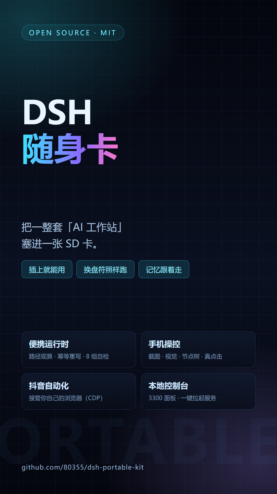

# DSH 随身卡 · Portable Kit

> 把一整套「AI 自己动手」的本地工作栈塞进一张 SD 卡：插上就能用，换台电脑也还是它。
> 包含 **便携卡运行时**、**手机操控**、**抖音自动化**、**本地控制台** 四块。

<p align="center">
  
</p>

---

## 这是什么

DSH（DeepSeek Harness）是个能读写文件、跑命令、开浏览器的本地 AI agent。这个仓库不重复造 agent，
而是解决「**怎么让它真正落地成一个随身、能动手的系统**」这件事：

| 模块 | 解决什么 | 目录 |
| --- | --- | --- |
| **随身卡** | 整套栈（运行时 + 配置 + 记忆 + 插件）装进一张 SD 卡，盘符随便变、换机即用 | [`portable/`](portable/) |
| **手机操控** | 让 agent 真的去点手机：截图 → 视觉理解 → 坐标点击 → 中文输入 → 节点树兜底 | [`tools/phone/`](tools/phone/) |
| **抖音自动化** | 用本机浏览器 + CDP 驱动抖音：刷视频、抓内容、发私信、按主题自动分享 | [`scripts/douyin/`](scripts/douyin/) |
| **本地控制台** | 一个 3300 端口的网页面板，一键拉起/重启 QQ 桥接、SnowLuma、DSH 本体 | [`console/`](console/) |

配套的 QQ 机器人桥接是独立公开项目：[**Derpyu520/qq-bridge**](https://github.com/Derpyu520/qq-bridge)。
本仓库只做「链接」，不复制它的代码。

---

## 亮点（不是又一个 dotfiles 仓库）

### 1. 真·便携：盘符变了也能跑

硬编码绝对路径是所有「绿色版」翻车的第一名。这里用**每次启动都幂等重写**的方式解决：

```bat
:: start-dsh.bat 里，全部路径都从 %~dp0 现算
set "DSH_HOME=%ROOT%\.dsh"
set "DSH_WORKSPACE=%ROOT%\workspace"
set "PATH=%ROOT%\node;%PATH%"
```

- [`portable/portable-repath.mjs`](portable/portable-repath.mjs) —— 启动前把 MCP 服务命令、
  依赖路径、插件入口统一重写成当前盘符下的真实路径，**跑多少遍结果都一样**（幂等）。
- [`portable/portable-verify.mjs`](portable/portable-verify.mjs) —— 8 组自检：node 能否执行、
  配置里还有没有写死的绝对路径、插件是不是实体目录、记忆/人格/凭据在不在、**整树有没有符号链接**。
  退出码 `0` 全绿 / `1` 有失败 / `2` 致命。

一个真实踩坑：SD 卡通常是 **exFAT**，而 exFAT **不支持 junction / 符号链接**。
仓库里因此带了一份「把链接实体化成真实目录」的复制脚本（`sync-to-card.ps1` 的姊妹逻辑），
自检里也专门有一条断言「全树无链接」，防止哪天又悄悄插了个 junction 进去。

### 2. 声明式裁剪：整套栈按需开关

卡上放不下两个 34GB 的语音模型？不要改代码，写一行清单就行：

```text
# portable-strip.txt —— 一行一个要关掉的配置块 id 前缀
mcp-tts-voice
```

`repath` 会把 `cordis.patch.yml` 里对应的缩进块整段摘掉，并留一行注释说明是谁摘的、什么时候摘的。
想加回来？删掉那一行重跑即可。

### 3. 图形化控制台：开关模块 + 填 API Key，不用碰配置文件

不用打开编辑器改 YAML。`console/server.mjs` 在 `http://127.0.0.1:3300` 起一个本地面板，
里面有一块「⚙️ 模块开关 & API 配置」：

- **本地服务开关** —— QQ 模块（3100）、SnowLuma 网关（5099）、抖音自动化、手机遥控；
- **MCP 工具开关** —— `mcp-snowluma` / `mcp-snowluma-host` / `mcp-web-search-safe` /
  `mcp-shared-memory` / `mcp-tts-voice`。勾掉就等于往 `portable-strip.txt` 里写一行、
  再跑一次 `repath` 把配置块摘掉，**重启 DSH 后这些工具就从列表里消失**（不是隐藏按钮，是真不给模型）；
- **API Key 输入框** —— 视觉 / 多模态、OpenAI 兼容、模型通道、备用线路四类。填好点「保存配置」，
  写进 `panel.config.json`（`.gitignore` 已忽略），之后拉起的 SnowLuma / QQ 桥接 / DSH 子进程都带上这些环境变量。
  已经存过的 Key 回读时**只显示 `sk-d…3456` 这种打码形式**，不会把明文吐回前端。

只想用命令行也行：`GET/POST /api/settings` 同一套逻辑。

> 安全提示：面板只监听 `127.0.0.1`，并且只接受来自 `http://127.0.0.1:3300` 的跨域请求。
> 它**不校验鉴权**——能开这台机器的人本来就能读到那些配置，别把 3300 暴露到局域网。

### 4. 手机操控：视觉只用来理解，点击一律走节点

纯视觉坐标点击在真机上抖动很大（分辨率、缩放、刘海、`dumpsys` 坐标系不一致）。
这套工具的规矩是：

```
截图 → 叠坐标网格 → 视觉模型读语义 → 用 uiNodes()/findNode() 拿真实 cx/cy → tap
```

- 截图、网格、压缩、PNG 头尾校验一条链（PNG 写坏了会让上游直接 `upstream_error`）。
- 中文输入不依赖输入法：`ADBKeyboard` 的 base64 广播 `am broadcast -a ADB_INPUT_B64 --es msg <base64>`。
- 无线调试优先：USB 会掉线，`adb pair <ip>:<port> <code>` 之后走 `_adb-tls-connect`。
- 详见 [docs/手机操控.md](docs/手机操控.md)。

### 5. 抖音自动化：不开无头浏览器，直接接管你自己的浏览器

不模拟登录、不碰风控接口。用本机 Edge/Chrome 开 `--remote-debugging-port=9222`，
脚本走 CDP 操作真实页面——账号状态、推荐流、私信都是你本人的。

- `browse.mjs` 刷推荐流、抓标题/作者/时长；
- `dm.mjs` 列会话、打开会话、发消息；
- `auto-share-watch.mjs` 按主题挑视频，自动私信分享给指定好友（可配预算与时间窗）。

详见 [docs/抖音自动化.md](docs/抖音自动化.md)。

### 6. 厂商系统适配实录

荣耀 MagicOS 的 iAware 会在**前台**都冻结第三方进程，`NotificationListenerService` 会被系统层
拦掉绑定。仓库里带一份实测记录（[docs/MagicOS适配实录.md](docs/MagicOS适配实录.md)）：
logcat 里的证据长什么样、adb 层哪些豁免根本无效、最后哪些必须用户手动在系统 UI 里点。

---

## 快速开始

### 方式 A：直接用这份仓库搭一套自己的

```bash
git clone https://github.com/<you>/dsh-portable-kit.git
cd dsh-portable-kit
node portable/portable-verify.mjs   # 先看缺什么（此时会报很多失败，正常）
```

按 [docs/便携卡使用说明.md](docs/便携卡使用说明.md) 把 DSH 运行时拷进卡，
再补上 `node/`、`.dsh/`、`workspace/` 三个目录，最后 `start-dsh.bat`。

### 方式 B：只要你已有的那套变得可搬运

1. 把 `portable/*` 拷到你现有栈的根目录；
2. 跑一次 `node portable-repath.mjs`（把写死路径改成相对当前根）；
3. 跑 `node portable-verify.mjs`，按它的报错逐条清干净。

---

## 目录结构

```text
dsh-portable-kit/
├── portable/            # 便携运行时（启动、路径重写、自检、同步）
├── tools/phone/         # 手机操控（ADB + 视觉 + 节点树 + 中文输入）
├── scripts/douyin/      # 抖音自动化（CDP）
├── console/             # 本地控制台（3300 端口网页面板）
├── docs/                # 中文文档：便携卡 / 手机操控 / 抖音 / 配置 / 架构 / MagicOS 实录
├── examples/            # 可直接改的配置模板（清单、面板、人格卡）
└── assets/              # 宣传图与截图
```

---

## 平台要求

| 项 | 要求 |
| --- | --- |
| 系统 | Windows 10 / 11 x64（脚本用了 `.bat` + PowerShell） |
| Node | ≥ 22.13（卡上自带便携 node 时不用另装） |
| 手机 | Android 11+，需开 USB/无线调试 |
| 浏览器 | Edge 或 Chrome（抖音自动化需要 CDP） |
| 磁盘 | 卡建议 ≥ 64GB（不含语音模型约 22GB） |

---

## 已知限制

- **exFAT 无权限控制**：卡丢了/插公共电脑上，里面的凭据文件等于明文。别这么干。
- **别在卡上跑 `pnpm install`**：exFAT 的写放大与硬链接语义会让安装变得又慢又容易坏。装依赖请在 NTFS 盘上进行后同步。
- **语音模型默认不带**：两个模型合计 34.4GB，按需自行加入（见 strip 清单说明）。
- **Python venv 不可搬迁**：`venv` 里写死了本机 Python 路径，换机需重建。
- **手机操控靠视觉模型**：没有 Key 跑不了；视觉只做理解，不要拿它的坐标直接点。
- **MagicOS / 部分国产 ROM** 需要用户手动白名单，adb 改不了（见 `docs/MagicOS适配实录.md`）。

---

## 隐私

本仓库**不含**任何个人路径、设备序列号、账号昵称、API Key、聊天记录。
所有敏感项都改成了环境变量，见 [docs/配置说明.md](docs/配置说明.md)。
如果你 fork 后自己用，记得把 `.env` / `panel.config.json` / 凭据文件加进 `.gitignore`（已预置）。

---

## 许可

MIT，见 [LICENSE](LICENSE)。

第三方致谢：

- [DeepSeek Harness](https://github.com/deepseek-ai) —— 本栈的 agent 运行时（本项目只是它的周边工具集）。
- [Derpyu520/qq-bridge](https://github.com/Derpyu520/qq-bridge) —— QQ 机器人桥接（MIT）。
- [ql0423/dsh-screen](https://github.com/ql0423/dsh-screen) —— 桌面操控插件（MIT），本仓库不复制其代码。
- [ADBKeyboard](https://github.com/senzhk/ADBKeyBoard) —— 中文输入方案。